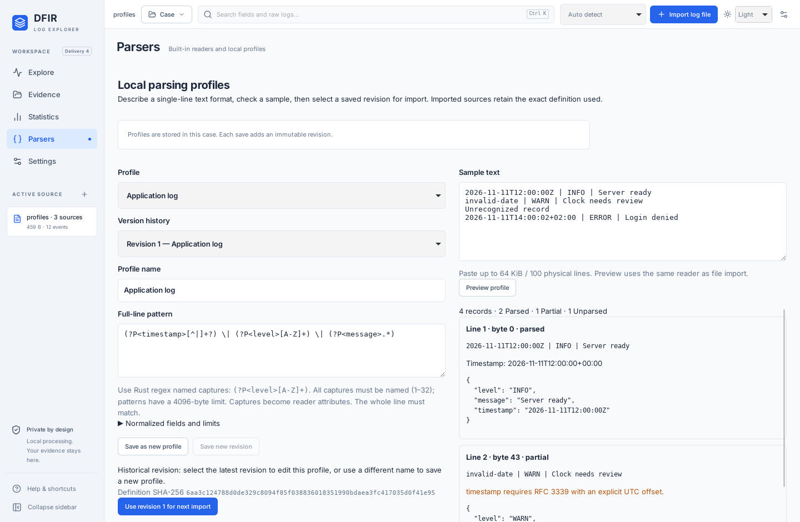

# Delivery 4 validation record

Recorded on November 11, 2026 for version **0.5.0**, branch `codex/12-15-delivery-4`, based on accepted `main` at `2173d09`. The user authorized this delivery and selected the initial application text format and profile model. Issues #12–#15 hold the decisions, PR/CI links, live status and handover; this document records executed local verification and its limits. All imported/previewed test evidence is synthetic.

## Executed local checks

| Check                                                                           | Actual result                                                                                                                                                                                                                                                                                                                                                                                                                                                                                                      |
| ------------------------------------------------------------------------------- | ------------------------------------------------------------------------------------------------------------------------------------------------------------------------------------------------------------------------------------------------------------------------------------------------------------------------------------------------------------------------------------------------------------------------------------------------------------------------------------------------------------------ |
| `cargo test --workspace --locked --offline`                                     | Passed: 58 Rust tests, including 11 new profile tests; desktop and documentation test targets compile.                                                                                                                                                                                                                                                                                                                                                                                                             |
| `cargo clippy --workspace --all-targets --locked --offline -- -D warnings`      | Passed.                                                                                                                                                                                                                                                                                                                                                                                                                                                                                                            |
| `cargo fmt --all --check`                                                       | Passed.                                                                                                                                                                                                                                                                                                                                                                                                                                                                                                            |
| `npm run build`                                                                 | Passed: TypeScript and production Vite assets.                                                                                                                                                                                                                                                                                                                                                                                                                                                                     |
| `npm test`                                                                      | Passed: five preview tests.                                                                                                                                                                                                                                                                                                                                                                                                                                                                                        |
| `PLAYWRIGHT_BROWSERS_PATH=/tmp/dfir-playwright npm run test:e2e -- --workers=2` | Passed: 18 Chromium workflows, including the new desktop-boundary profile scenario.                                                                                                                                                                                                                                                                                                                                                                                                                                |
| `npm run desktop:build -- --debug --bundles deb`                                | Passed: Linux v0.5.0 application and 26.99 MiB `.deb`; no installation or service changes.                                                                                                                                                                                                                                                                                                                                                                                                                         |
| Native Linux profile workflow                                                   | Passed: actual React/Tauri preview, invalid rule feedback, revision creation, current/historical imports through real file dialogs, save/new/reopen, source definition retention, attribute queries, unchanged evidence, and protection of an unsaved profiles-only case. The complete final native run also passed baseline, persistent-case, security-reader and saved-search workflows. Light 1440×940 and Dark 1000×720 profile screens were inspected; the narrow screen has no horizontal document overflow. |
| `npm run format:check`, Git whitespace and documentation integrity              | Passed after the acceptance/validation documents were completed; relative documentation targets and synchronized 0.5.0 package metadata also passed.                                                                                                                                                                                                                                                                                                                                                               |

## Coverage and corrected initial attempts

The new Rust tests cover full-line preview/import equivalence for fields, attributes, diagnostics, physical lines and byte offsets; valid/partial/unparsed records; RFC 3339 timezone preservation and normalized number validation; immutable definitions and source snapshots; stale revision conflicts; save/reopen; optional extension behavior on legacy cases; unsupported/malformed/oversized definitions; digest/identifier/history corruption; capture/pattern/compiled-size limits; UTF-8 byte and physical-line preview bounds; profile/revision count limits; historical imports; cancellation/oversized-line rollback; and stored original bytes including CRLF and invalid UTF-8. The earlier source/saved-query/security-reader suites continue to run in the workspace test command.

Initial compilation of the new tests exposed incorrect test accesses to the flattened event field structure; these were corrected to use `event.fields`. The first equivalence assertions also compared inspector display text with sample terminators. The inspector intentionally omits terminators; the assertions now compare display text consistently and a separate test reads stored raw BLOBs to establish byte preservation. Production raw storage behavior was retained.

The first browser attempt exposed an unsuitable disabled-state matcher on an HTML `option` and a timing race in the existing synthetic import cancellation test when the import completed before the click under load. The new option assertion checks its native disabled property; the cancellation test pauses/advances the browser clock to exercise cancellation deterministically without changing product timing. A following new test assertion expected an Explore heading on the empty workspace, which actually displays its welcome heading; the assertion now checks both the chosen parser and that welcome screen. No failed attempt is counted as a successful complete run.

Rust 1.99.0, Rustfmt/Clippy, Cargo dependencies, Chromium and tauri-driver were prepared under `/tmp`. Node.js 24 and the existing locked frontend dependencies were used. No shell profile, global Git identity, credential, server service, firewall or system package configuration was changed. Test listeners/displays/drivers run with the necessary execution approval. Native file/save/open dialogs use the existing test-only X11 helper; no path-writing or file-access API was added to the webview.

## Native review capture

The actual Linux application displaying historical revision 1 and the synthetic preview after save/reopen:

## Remaining acceptance and limitations

- Local Rust/native/package checks use the debug profile. Release-mode Linux/Windows tests and installer builds run through the existing PR CI workflow and must be read from its actual results; queued/running jobs are not successful checks.
- Interactive Windows application acceptance, a new native offline-traffic audit and representative large-volume measurements were not executed locally. These remain limitations, even with successful automated platform builds.
- The agreed first acceptance format is the synthetic application log. The profile mechanism supports other single-line layouts within its contract, but arbitrary vendor formats and performance targets have not been accepted or benchmarked.
- Preview rejects more than 64 KiB or 100 physical lines. Profile storage allows 50 profiles, 20 revisions each, 200 revisions total and 16 KiB per revision. Profiles contain no executable code; bounded regex compilation does not establish a wall-clock or total-process-memory guarantee.
- Profiles are case-local. There is no profile deletion, machine-wide library, separate profile exchange or automatic migration/downgrade. Profile cases remain unencrypted. Older applications cannot read sources using the new custom-reader category.
- The [acceptance contract](delivery-4-acceptance.md) documents exact behavior, compatibility and human scenarios. Human acceptance and explicit merge authorization remain required; Delivery 5 is not authorized.
