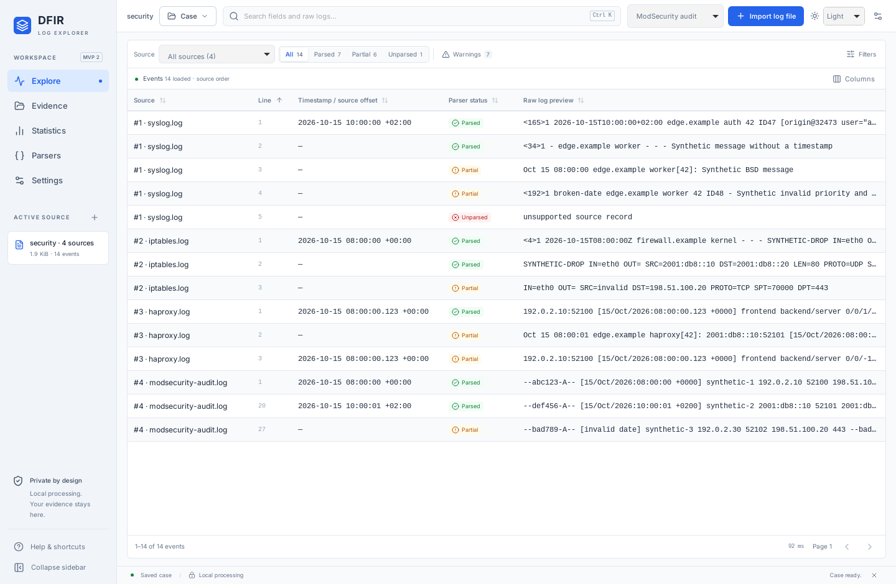

# MVP 2 validation record

Recorded on 2026-10-15 for version 0.3.0 on the Ubuntu 24.04 x64 development VPS. Rust 1.99.0, Node.js 24.21.0, locked DuckDB/Tauri dependencies. All evidence is synthetic. This report distinguishes executed local checks from pending platform acceptance.

## Executed local checks

| Check                                          | Actual result                                                                                                                                                                                                                                         |
| ---------------------------------------------- | ----------------------------------------------------------------------------------------------------------------------------------------------------------------------------------------------------------------------------------------------------- |
| Rust workspace tests                           | Passed: 38 tests (27 existing, 11 new), with desktop targets and doc-test targets compiling.                                                                                                                                                          |
| Workspace Clippy, all targets, warnings denied | Passed.                                                                                                                                                                                                                                               |
| Rust formatting                                | Passed.                                                                                                                                                                                                                                               |
| TypeScript and Vite production build           | Passed.                                                                                                                                                                                                                                               |
| TypeScript preview tests                       | Passed: 3 tests.                                                                                                                                                                                                                                      |
| Chromium UI workflows                          | Passed: 13 workflows, including explicit security-reader choices, attribute filtering and the existing compact workspace/Statistics regressions.                                                                                                      |
| Linux debug installer                          | Passed: `DFIR Log Explorer_0.3.0_amd64.deb`, 26.73 MiB. Built locally without installing or restarting a service.                                                                                                                                     |
| Native Linux baseline smoke                    | Passed with the real desktop bridge, import, detail, global query/statistics and parsing diagnostics.                                                                                                                                                 |
| Native Linux persistent-case regression        | Passed with real save/open dialogs, Nginx/JSON imports, combined filters and source provenance.                                                                                                                                                       |
| Native Linux MVP 2 workflow                    | Passed: four real file-picker imports (14 events), ModSecurity source-line range 1–19, two WAF findings without parse warnings, reader/attribute filtering, inspector attribute action, save/new/open, identical reopened metadata and event details. |

The native tests use Xvfb, a private DBus session, tauri-driver/WebKitWebDriver and software compositing. X11 keyboard input is limited to test dialog interaction; the production webview gains no filesystem path API. Tests create local cases in temporary directories and close them before cleanup.

Commands (standard Rust/Node environments):

```sh
cargo fmt --all --check
cargo test --workspace --locked --offline
cargo clippy --workspace --all-targets --locked --offline -- -D warnings
npm run build
npm test
npm run test:e2e
# Inside an isolated Xvfb/DBus session with tauri-driver on port 4444:
python3 tests/native_smoke.py /absolute/path/to/dfir-log-explorer
python3 tests/native_cases.py /absolute/path/to/dfir-log-explorer
python3 tests/native_security_formats.py /absolute/path/to/dfir-log-explorer
```

Local toolchain/cache directories are environment-specific. Chromium used the previously installed browser cache. The initial sandbox could not start Vite; rerunning with local-port access resolved that infrastructure failure. An initial Chromium run lacked the browser-cache location; no application tests executed in that run. A subsequent run identified the legacy five-reader UI assertion; it now expects nine readers and the final full suite passes. Clippy's initial question-mark suggestion was applied before the final successful run.

Native four-source case after reopening (synthetic evidence):



## New regression coverage

The eleven new Rust tests cover Syslog explicit offsets, NILVALUE, structured-data escapes, malformed/duplicate/colliding attributes, BSD date ambiguity, invalid priorities/versions/dates, firewall IPv4/IPv6 and independent port validation, HAProxy request-date ambiguity and logasap semantics, multiline source lines/byte offsets/hash/progress, EOF and CRLF/invalid UTF-8, resynchronization and mismatched/duplicate sections, cancellation inside unfinished framing, aggregate size rollback in saved cases, contiguous logical event IDs, combined literal/attribute/source/reader/date-presence filters after reopening, bounded page attributes and prior summaries without the new optional physical-line metadata.

Fixtures establish behavior for the selected layouts in the [format contract](mvp-2-formats.md). They are not captured vendor datasets or a claim of universal device support.

## Platform and scope limits

The [MVP 2 workflow](../.github/workflows/mvp-2.yml) checks and packages Linux/Windows independently in release mode. Its run for the PR commit is the authoritative CI/artifact record. Local workspace tests and Clippy used the debug profile; a redundant local release workspace compilation was interrupted before completion and is not reported as a passing check.

Interactive Windows acceptance, a new native offline-traffic audit and a representative large-volume benchmark were not performed for MVP 2. Existing MVP 1 performance measurements are not reclassified as MVP 2 measurements. Saved cases remain unencrypted, and cases containing new reader modes should be opened with 0.3.0 or later. ModSecurity records over 1 MiB fail atomically rather than being truncated. Standard HAProxy and BSD dates remain undated with explicit diagnostics. These are documented limits, not unresolved test failures.

Human acceptance remains outstanding; follow the [MVP 2 acceptance guide](mvp-2-acceptance.md). No automatic merge is authorized.
